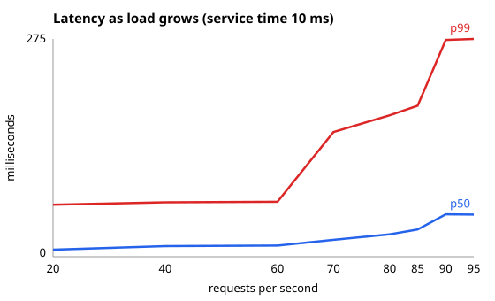

# Part 1: Finding the knee

## 1. The idea in plain words

A server can look healthy while its queue is still growing. As incoming work approaches the server's maximum processing rate, requests spend more time waiting, so the high percentiles rise before every request becomes slow. This experiment increases the request rate and looks for the point where tail latency starts to bend sharply upward: the **knee**.

The server does about 10 ms of work per request, so one worker has a rough capacity of `1000 / 10 = 100` requests per second. That is a useful estimate, not a promise: scheduling, random service times, and bursts affect the measured result.

## 2. An everyday comparison

Imagine one cashier serving a line. At 20 customers per minute, a new customer usually reaches the cashier quickly. At 95 customers per minute, the cashier is almost always busy; a small arrival burst creates a long line. The average wait may hide that experience, while the slowest few waits reveal it immediately.

## 3. What the script does

| Step | What happens | Script lines |
|---|---|---|
| 1 | Set 10 ms service work, ten-second steps, and the request-rate levels to test. | [`knee.js:6-8`](./knee.js#L6-L8) |
| 2 | Start the one-worker server and calculate its approximate 100 requests/second capacity. | [`knee.js:10-11`](./knee.js#L10-L11) |
| 3 | For each rate, generate open-loop traffic and wait for all responses. | [`knee.js:17-18`](./knee.js#L17-L18) |
| 4 | Summarize the samples, calculate utilization, and calculate the M/M/1 comparison. | [`knee.js:19-21`](./knee.js#L19-L21) |
| 5 | Save p50 and p99 points for the chart, then print all latency columns. | [`knee.js:22-27`](./knee.js#L22-L27) |
| 6 | Stop the server and write the SVG chart. | [`knee.js:29-40`](./knee.js#L29-L40) |

## 4. Where every number comes from

- `10 ms` is `SERVICE_MS` in [`knee.js:6`](./knee.js#L6), and is passed to the server as its average exponential service time.
- `100 requests/second` is `1000 / 10`, calculated in [`knee.js:11`](./knee.js#L11).
- The tested rates (`20` through `95`) come from `RATES` in [`knee.js:8`](./knee.js#L8).
- `busy` is the tested rate divided by capacity, rounded to a percentage in [`knee.js:20`](./knee.js#L20).
- p50, p95, p99, and mean are calculated by `summarize` from the measured request latencies in [`knee.js:18-19`](./knee.js#L18-L19).
- The comparison column uses `W = 1 / (mu - lambda)`, converted to milliseconds, in [`knee.js:21`](./knee.js#L21). For example, at 70 requests/second: `1000 / (100 - 70) = 33.3 ms`.
- The chart contains the measured p50 and p99 values selected in [`knee.js:22`](./knee.js#L22) and written in [`knee.js:31-39`](./knee.js#L31-L39).

## 5. Results

The run found a knee at about **70 requests per second**. p99 was **69.4 ms** at 60 requests/second, then **157.6 ms** at 70 requests/second. The measured mean was close to the M/M/1 estimate at 20, 40, and 70 requests/second, but the finite run and event-loop scheduling made the higher-load measurements less predictable.

