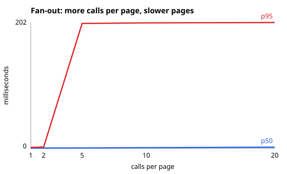

# Part 2: When percentiles tell a different story

## 1. The idea in plain words

A mean is one number made by adding every latency and dividing by the number of requests. It can make a system with rare, very slow calls look acceptable. Percentiles show the boundary experienced by the slower part of the traffic: p95 is the latency that 95% of requests are at or below, leaving the slowest 5% above it.

Fan-out makes the problem larger. A page is only as fast as its slowest parallel dependency, so each extra call creates another chance to include a 200 ms call.

## 2. An everyday comparison

Consider a form that needs several offices to approve it. Each office usually answers immediately, but 2% take 200 ms. With one office, a delay is unusual. With twenty offices, it is much more likely that at least one office is delayed, so the whole form waits even though most individual offices were quick.

## 3. What the script does

| Step | What happens | Script lines |
|---|---|---|
| 1 | Set a 2% slow-call chance, a 200 ms slow delay, and the page fan-out values. | [`tail.js:7-9`](./tail.js#L7-L9) |
| 2 | Start a nearly-free server configured with those slow-call settings. | [`tail.js:11-14`](./tail.js#L11-L14) |
| 3 | For each fan-out value, send pages at 40 requests/second, with every page making that many calls. | [`tail.js:20`](./tail.js#L20) |
| 4 | Summarize page latency, count pages reaching 200 ms, and calculate the predicted probability. | [`tail.js:21-23`](./tail.js#L21-L23) |
| 5 | Record p50 and p95 for the chart and print mean, percentiles, and both slow-page percentages. | [`tail.js:24-29`](./tail.js#L24-L29) |
| 6 | Stop the server and write the fan-out chart. | [`tail.js:31-40`](./tail.js#L31-L40) |

## 4. Where every number comes from

- `2%` is `SLOW_CHANCE = 0.02` in [`tail.js:7`](./tail.js#L7).
- `200 ms` is `SLOW_MS` in [`tail.js:8`](./tail.js#L8).
- The calls-per-page values (`1, 2, 5, 10, 20`) are `FANOUTS` in [`tail.js:9`](./tail.js#L9).
- Each measurement uses 40 page requests per second for 10 seconds, as configured in [`tail.js:20`](./tail.js#L20).
- Mean, p50, p95, and p99 come from `summarize` over the observed page latencies in [`tail.js:21`](./tail.js#L21).
- The observed slow-page column counts page latencies at least 200 ms in [`tail.js:22`](./tail.js#L22).
- The predicted column uses `1 - (1 - 0.02)^fanout` in [`tail.js:23`](./tail.js#L23). For 20 calls, that predicts about `33%` of pages containing at least one slow call.
- The chart uses p50 and p95, selected in [`tail.js:24`](./tail.js#L24) and written in [`tail.js:33-39`](./tail.js#L33-L39).

## 5. Results

The run measured means from **4.0 ms** at one call per page to **63.1 ms** at twenty calls, which could still sound manageable if the mean were the only metric. p95 showed the practical risk: it rose from **1.5 ms** to **202.1 ms**, and the observed slow-page share reached **31%** at twenty calls per page. Fan-out turns a 2% per-call event into a common page-level event.

