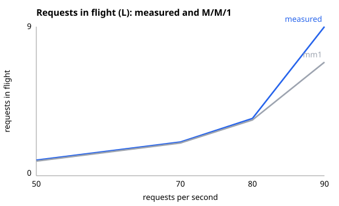

| rate/s | lambda/s | W ms | L measured | lambda x W | M/M/1 L |
|---:|---:|---:|---:|---:|---:|
| 50 | 47.1 | 20.2 | 0.95 | 0.95 | 0.89 |
| 70 | 66.7 | 30.9 | 2.06 | 2.06 | 2.00 |
| 80 | 77.3 | 45.3 | 3.50 | 3.50 | 3.41 |
| 90 | 87.4 | 104.3 | 9.11 | 9.11 | 6.94 |

L matched lambda x W in all four rows.

M/M/1 was close for the first three rows and farthest at 90 requests/s.

